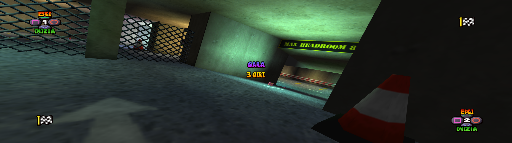
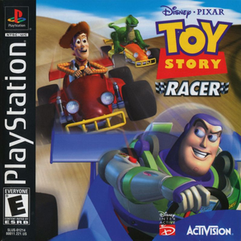

# Toy Story Racer Recompiled

<!-- retcomm-readme-metrics -->
[](https://github.com/IraFunesto/ToyStoryRacerRecomp/releases)
[](https://github.com/IraFunesto/ToyStoryRacerRecomp/releases/latest)
[](https://github.com/IraFunesto/ToyStoryRacerRecomp/releases/latest)
<!-- /retcomm-readme-metrics -->

<p align="center">
  
</p>

Static recompilation of **Disney•Pixar Toy Story Racer** (PlayStation, PAL
SLES-03398, Spanish / Italian / Dutch) built on
[psxrecomp](https://github.com/mstan/psxrecomp) and
[recomp-ui](https://github.com/RetroPortingToolKit/recomp-ui). The game runs
as native code on your PC, compiled from your own disc, with a widescreen mod,
a native 3D renderer for the tracks and a set of fixes on top.



| | |
|---|---|
| Players | 2 (split screen) |
| Region | PAL (Europe) |
| Publisher | Disney Interactive |
| Year | 2001 |

## What this adds

All enhancements live in the bundled **Toy Story Racer Widescreen** mod
package (launcher → Mods) and can be switched off.

On a first start the game is set up the way it is meant to be played:
widescreen with the native renderer on, the window opening in the shape of
your monitor, 960-line internal resolution with bilinear filtering, and the
framework's PGXP package on. Every one of them can be changed in the
launcher (Settings and Mods); an existing install keeps its own choices.

**The disc as files** — at the first start the game splits your disc image
into the `tsr_data` folder of the install: every data file as a normal file,
the music, voices and videos with their full sectors, and the few sectors no
file owns. Every sector is rebuilt and compared with the image before the
folder is used. From then on everything — boot, loads, music, voices,
videos, and Generate & rebuild — comes from that folder: the image is not
read any more, and is not needed to play. `tsr_data` holds the game's data:
never share it.

**Instant loading** (Fixes group, on by default) — the game's file loads are
answered at once from the folder instead of waiting for the emulated CD
drive to seek and read; the music and voices still stream in real time, as
on the console. The framework's CD Speed and Fast Loading packages are left
out of this build: they are not needed, and Fast Loading would speed the
game itself up while the music streams.

**Widescreen** (fit to window, 16:9, 21:9 or 32:9) — a real wider field of
view, not a stretched picture; Fit to window first opens in the shape of
your monitor:
- tracks and objects are drawn all the way to the screen edges, in one and two
  player races; the cloud sky of the title and level select fills the width
  too;
- the race HUD is anchored to the corners, and so are the prompts of the
  menus, level select, track preview and pause screen (the character select
  prompts keep following the characters' heads);
- *Track draw distance*: the original hides scenery outside the 4:3 view;
  Extended doubles the draw distance, Full (default) also ignores the 4:3
  visibility lists, so nothing pops in at the sides.

**Native scenery renderer** (default on) — the track scenery, the karts and
the characters are drawn by the PC instead of the emulated PlayStation GPU:
no wobbling textures or jittering polygons, correct depth between pieces, no
polygons cut at the 4:3 edges.

**50 fps races** — the PAL game runs at 25 fps; races can run at 50 fps (one
player by default, two players optional on a fast PC). Game speed and music
are unchanged.

**HUD size** — 100 / 85 / 75 / 65 % (default 85 %): the low-resolution HUD
and menu art is drawn smaller so it looks sharper next to the high-resolution
game.

**Track preview camera** — while the camera flies over the track before a
race, Select holds it in place; then L1 / R1 move it back and forth along its
path, L2 / R2 four times as fast. Select again lets it fly on.

**Other options**: CPU overclock (races only; keeps two-player races at full
rate), near-polygon pool size, frame smoothing, race progress bar position,
VSync on high-refresh monitors, skip the intro videos.

**Fixes**
- Character voices no longer stall the menus while they load.
- Music changes no longer hitch.
- Pier: a corrupted sea-grid record on the European disc crashed the
  original GPU; broken packets are now dropped instead of halting the game.
- Pick-up crates no longer float in mid-air in wide views (a 32-bit overflow
  in the game's object position maths).
- Scenery no longer vanishes during jumps and falls (Skate Park) or at long
  range (fences and roofs in the Neighbourhood), and the sky of the outdoor
  tracks reaches the edges and the top of a 32:9 view.
- The star-shaped scene transition covers the whole 32:9 view.
- Lamp halos are round (no faint square around them) and no longer shine
  through walls.
- Two-player end-of-race camera cuts no longer flash shrunken prompts and
  stale margins for a frame.
- Track seen through a doorway at the sides of a wide view is drawn at once
  (Toy Store finish), and rooms whose doorway is above or below the view no
  longer vanish (Car Park pillar, barrier and wall with the camera high).
- Rooms seen through a doorway keep the scenery above and below it (the far
  wall of the house's upstairs corridor).
- No more one-frame gaps in the track ahead (Car Park landings) and no more
  one-frame 4:3 picture when pressing X or Triangle in the character select.
- Snow falls across the whole wide view.
- Faster widescreen rendering: the side margins are drawn in one pass per
  frame and the scenery's transparent faces in batches (Toy Store worst case:
  GPU load about 77% -> 32% on an RTX 4070 at 32:9, 6x).
- Repairs the track data of dumps with read errors (see below).

Plus everything psxrecomp provides: high internal resolution, texture
filtering, save states, controller rumble.

## Disc dumps

Two dumps of the European disc (SLES-03398) are accepted. The first is clean:
every sector's error-detection code checks out. The second, the dump this
project was first built from, has 78 misread sectors: about 45 values in ten
track files (`3E 3E` where the disc has `80 3F` / `10 3F`), which break
textures and geometry on Skate Park, Pier, Car Lot, Cinema and Neighbourhood,
plus a few music, voice and video sectors.

The **Track data fix** feature (Fixes group, on by default) restores those
track values while the disc is read. It is a list of guarded patches in the
mod manifest: no game data is shipped, and on a clean dump it changes
nothing. If your dump is rejected, make a fresh one with
[redumper](https://github.com/superg/redumper).

The runtime can also read any file placed under `disc_override/` next to the
game executable instead of the one on the disc (same path, e.g.
`disc_override/COURSE_B/PIER.AXE`), for testing replacement data.

## How to play

1. Download the latest zip from
   [Releases](https://github.com/IraFunesto/ToyStoryRacerRecomp/releases/latest)
   and extract it into a new folder.
2. Run `ToyStoryRacer_Recompiled.exe`. Nothing else needs installing: on
   first use the launcher downloads its own portable toolchain (CMake, Clang
   and Python).
3. Select your own disc (.cue/.bin of SLES-03398) and follow the
   **Generate & rebuild** wizard: the game is compiled on your PC.
4. Press **Play**: widescreen and the native renderer are already on; the
   launcher's Mods page has every option.

The download contains no game data and no Sony BIOS; OpenBIOS (MIT-licensed)
is used when you do not provide your own.

## Framework changes

The game needs a few additions to psxrecomp (a linked-list hook for the menu
prompts, disc file overrides, CD/XA loading, GPU packet safety, CPU overclock
and more). They ship inside the release zip and are kept here as
`patches/psxrecomp-toystoryracer.patch` against the pinned `psxrecomp`
submodule commit.

## Legal

You must own the original game. Disc images and files taken from discs are
gitignored and must never be committed. Retail BIOS dumps are not
redistributed; OpenBIOS is used for Generate unless you supply your own SCPH
locally.

App icon: the Toy Story Racer logo (`assets/psxrecomp.ico` / `.png`); Windows
builds embed it via `APP_ICON`. Launcher box art: `launcher_assets/img/`
(see `BOXART_SOURCE.txt`).

## Quick start (dev)

```bash
git submodule update --init --recursive
git -C psxrecomp apply --ignore-whitespace ../patches/psxrecomp-toystoryracer.patch
./psxrecomp/tools/ci/build_emitters.sh
python3 psxrecomp/psxrecomp_cli.py generate \
  --config game.toml --project-root . --disc disc/<your>.cue
cmake -S . -B build-release -G Ninja -DCMAKE_BUILD_TYPE=Release
cmake --build build-release --target psx-runtime
```

Release kit (setup host, no Sony BIOS):

```bash
cmake -S . -B build-setup -G Ninja -DCMAKE_BUILD_TYPE=Release \
  -DPSXRECOMP_FORCE_SETUP_HOST=ON -DPSXRECOMP_BIOS_STEMS=OpenBIOS
cmake --build build-setup --target psx-runtime
RELEASE_VERSION=x.y.z bash scripts/package_setup_release.sh build-setup windows-x64
```

Zip prefix for CI artifacts: `tsr`.

## Symbols

Progressive map: `symbols.toml` → `python3 tools/sync_symbols.py` →
`psx_symbols.h` (`PSX_FN_*`). See `psxrecomp/docs/SYMBOLS.md`.

## Framework pins

Submodule gitlinks (`psxrecomp`, optional `recomp-ui`, nested `recomp-net`)
are authoritative. `framework_pins.txt` is an optional scaffold snapshot.
Bump submodules deliberately and refresh the patch when you do.
